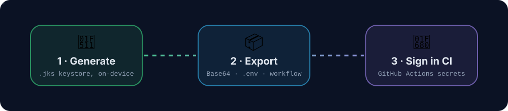

<div align="center">


<a href="https://github.com/TanzirEren/GitKey">
  
</a>

<br/>

[](https://www.android.com/)
[-2563EB?style=for-the-badge)](https://developer.android.com/)
[](https://developer.android.com/)
[](https://www.java.com/)

[](#-security--privacy)
[](https://m3.material.io/)
[](LICENSE)

[](https://github.com/TanzirEren/GitKey/actions)
[](https://github.com/TanzirEren/GitKey/releases/latest)
[](https://github.com/TanzirEren/GitKey/releases)
[](https://github.com/TanzirEren/GitKey/stargazers)

<br/>

**[📖 Overview](#-overview)** &nbsp;•&nbsp;
**[✨ Features](#-features)** &nbsp;•&nbsp;
**[🔒 Security](#-security--privacy)** &nbsp;•&nbsp;
**[📥 Download](#-download--install)** &nbsp;•&nbsp;
**[🛠️ CI/CD](#%EF%B8%8F-github-actions-cicd-integration)** &nbsp;•&nbsp;
**[🚀 Build](#-building-from-source)**


</div>

## 📖 Overview

Generating Android signing keystores the traditional way means terminal commands (`keytool`), tricky Distinguished Name (DN) parameters, and manual Base64 conversion before you can even touch a CI/CD pipeline.

**GitKey** puts production-grade key management in your pocket. Build industry-standard `.jks` keystores, inspect certificates, re-download binary or environment files, edit earlier projects, and format GitHub Repository Secrets in seconds. Everything runs **offline**, with **no internet permission** and **no cloud tracking**.

<div align="center">
  
</div>

> [!TIP]
> No laptop? GitKey was built for phone-first developers: generate the key on your phone, copy the secrets, and let GitHub Actions do the signing.


## ✨ Features

GitKey v2 brings a full **Google Stitch** redesign (porcelain light theme, obsidian dark theme, refined typography, micro-animations, floating glass dock navigation) and **20+ professional developer features**. Expand any group below.

<details open>
<summary><b>🗝️ &nbsp;Key & Project Management</b></summary>
<br/>

| | Feature | What it does |
|:-:|---|---|
| 📋 | **Project Details Hub** | Alias, keystore filename, creation date, certificate validity and a live expiry countdown (`ProjectDetailActivity`). |
| ✏️ | **Edit Previous Projects** | Update name, alias, filename, release tag, validity, certificate identity (CN, Organization, Country), avatar and notes (`EditProjectActivity`). |
| 🧬 | **Keystore Cloning & Templating** | One-tap *Clone Settings* pre-fills the form from an existing project while generating fresh credentials. |
| ⭐ | **Favorites & Pinning** | Star important production keys to pin them to the top of your workspace. |
| 🔎 | **Real-Time Search & Filters** | Search by name, alias, filename, tag or SHA-256, with **All / ★ Starred / Active / Expired** chips. |
| 🩺 | **Certificate Health Monitor** | Live status such as *Active • X yrs left* or *Certificate Expired*. |
| 📝 | **Quick Developer Notes** | Keep release notes, Play Console tracks or deploy instructions right in the project. |

</details>

<details open>
<summary><b>📦 &nbsp;Export & Re-Download Suite</b></summary>
<br/>

| | Feature | What it does |
|:-:|---|---|
| 💾 | **Re-Download `.jks`** | Save the binary keystore to device storage with Android's Storage Access Framework (SAF). |
| 🔁 | **On-the-Fly `.jks` Rebuild** | Reconstruct the keystore from its Base64 record if the local file was cleared. |
| 🧾 | **Base64 Secrets (`.base64.txt`)** | Formatted for GitHub Actions, GitLab CI, Bitrise, CircleCI and Azure Pipelines. |
| 🌿 | **`.env` Export** | Ready-made file with `ANDROID_KEYSTORE_BASE64`, `KEY_ALIAS`, `KEYSTORE_PASSWORD`, `KEY_PASSWORD`. |
| ⚙️ | **Workflow Export** | Pre-configured `.github/workflows/build-and-sign.yml` for Gradle assemble/bundle tasks. |
| 📜 | **Public Certificate (`.pem`)** | Export the X.509 public certificate for Google Play App Signing or Firebase App Check. |
| 🧩 | **Gradle `signingConfigs`** | Toggle **Kotlin DSL (`.kts`)** or **Groovy (`.gradle`)** with one-tap copy. |
| 🔏 | **Fingerprint Copying** | Copy SHA-256, SHA-1 and MD5 formatted for Play Console and Firebase. |
| 🗄️ | **Vault Backup & Restore (JSON)** | Export the full vault to a portable `.json` file and restore it on another device or a fresh install. |

</details>

<details open>
<summary><b>🧰 &nbsp;Developer Toolbox</b></summary>
<br/>

| | Tool | What it does |
|:-:|---|---|
| 🔬 | **Keystore Inspector** | Inspect external `.jks` / `.keystore` files or Base64 strings: aliases, validity and fingerprints, without exposing private keys. |
| 🔤 | **Base64 Encoder / Decoder** | Encode text or any file to Base64, and decode back to text or file. |
| #️⃣ | **Hash Generators** | SHA-256, SHA-1 and MD5 from text or files. |
| ✅ | **Multi-File Checksum** | Generate MD5, SHA-1 and SHA-256 together and verify against an expected digest. |
| 🔐 | **GitHub Secrets Formatter** | Format and preview repository secrets with single-click copy. |
| 🎲 | **Password Generator** | Configurable, cryptographically random passwords with a smooth 360° rotation animation. |
| 🆔 | **UUID Generator** | Version-4 UUIDs for build IDs, release tags and tokens. |
| 🧹 | **JSON Formatter** | Validate, beautify and minify JSON locally. |

</details>

<details>
<summary><b>🎨 &nbsp;Design & Guidance</b></summary>
<br/>

| | Feature | What it does |
|:-:|---|---|
| 🌗 | **Adaptive Themes** | Porcelain Light, Obsidian Dark or System Default, with spring-animated dock tabs. |
| 📘 | **Interactive CI/CD Guide** | Step-by-step help for GitHub Repository Secrets and Play Console App Signing. |

</details>


## 🔒 Security & Privacy

| | Guarantee | Details |
|:-:|---|---|
| 📴 | **100% offline generation** | Keys are generated on-device with `java.security.KeyStore`, `KeyPairGenerator` and standard JCA providers (plus Bouncy Castle for X.509 certificates). |
| 🚫 | **No internet permission** | The manifest does **not** declare `android.permission.INTERNET`. Your private keys never leave the device. |
| 🧱 | **Private sandbox storage** | Keystores live in the app's private internal storage (`/data/user/0/com.gitkey.build/files/vault_keystores/`), inaccessible to other apps. |
| 🙈 | **Secrets concealed by default** | Passwords and Base64 strings are masked, with tap-to-reveal toggles. |
| 🛑 | **Export confirmation** | Optional guards prevent accidental export of sensitive signing material. |

> [!WARNING]
> Backups and `.env` exports contain real signing credentials. Store them somewhere safe and never commit them to a public repository.


## 📥 Download & Install

**Option A: Releases (recommended)**
1. Open the [**Releases**](https://github.com/TanzirEren/GitKey/releases/latest) page.
2. Download the latest `.apk`.
3. On your phone allow *Install unknown apps* for your browser or file manager, then open the APK.

**Option B: Build it yourself with GitHub Actions**
1. Fork or push this repo to your GitHub account.
2. Open **Actions → Build APK → Run workflow**.
3. When it finishes, download `GitKey-debug-apk` or `GitKey-release-apk` from the run's **Artifacts** section.

| Requirement | Value |
|---|---|
| Android version | 7.0 (API 24) or newer |
| Permissions | None (fully offline) |


## 🛠️ GitHub Actions CI/CD Integration

### Sign **your own** app with keys made in GitKey

**1. Add the secrets**  
Go to **Repository → Settings → Secrets and variables → Actions → New repository secret**:

| Secret name | Value |
|---|---|
| `ANDROID_KEYSTORE_BASE64` | Base64 string exported from GitKey |
| `KEY_ALIAS` | Your key alias (e.g. `release_key`) |
| `KEYSTORE_PASSWORD` | Your keystore password |
| `KEY_PASSWORD` | Your key password |

**2. Add the workflow** (`.github/workflows/build-and-sign.yml`)

<details>
<summary><b>Show workflow YAML</b></summary>

```yaml
name: Build and Sign Android Release

on:
  push:
    branches: [ "main" ]

jobs:
  build:
    runs-on: ubuntu-latest
    steps:
      - name: Checkout Code
        uses: actions/checkout@v4

      - name: Set up JDK 17
        uses: actions/setup-java@v4
        with:
          distribution: 'temurin'
          java-version: '17'

      - name: Decode Android Keystore
        run: |
          echo "${{ secrets.ANDROID_KEYSTORE_BASE64 }}" | base64 --decode > app/release-keystore.jks

      - name: Build Android App Bundle (.aab)
        env:
          KEYSTORE_PATH: "release-keystore.jks"
          KEYSTORE_PASSWORD: ${{ secrets.KEYSTORE_PASSWORD }}
          KEY_ALIAS: ${{ secrets.KEY_ALIAS }}
          KEY_PASSWORD: ${{ secrets.KEY_PASSWORD }}
        run: ./gradlew bundleRelease

      - name: Upload Artifact
        uses: actions/upload-artifact@v4
        with:
          name: app-release
          path: app/build/outputs/bundle/release/*.aab
```

</details>

### Build **GitKey itself** (this repository)

This repo ships its own workflow at [`.github/workflows/build-apk.yml`](.github/workflows/build-apk.yml). It builds a debug and a release APK on every push.

| Optional secret | Purpose |
|---|---|
| `KEYSTORE_BASE64` | Base64 of your release keystore (alias must be `upload`) |
| `STORE_PASSWORD` | Keystore password |
| `KEY_PASSWORD` | Key password (defaults to the store password) |

> [!NOTE]
> Without these secrets the workflow signs the release APK with a temporary key. It still installs fine, but each build has a different signature, so it won't update over a previous one. Add the secrets for a stable release signature.


## 💻 Tech Stack & Architecture

| Layer | Technology |
|---|---|
| Language | Java 11 |
| UI | Material Components 3 + custom Google Stitch styling, ViewBinding |
| Architecture | Modular, MVVM-inspired, with the Storage Access Framework (SAF) |
| Cryptography | `java.security`, `javax.crypto`, `KeyStore`, `X509Certificate`, Bouncy Castle (`bcprov` / `bcpkix` 1.78.1) |
| Persistence | `SharedPreferences` with a structured JSON vault index and file sandboxing |
| Build | Gradle 9.3.1 (wrapper), Android Gradle Plugin 9.1.1 |

<details>
<summary><b>📁 &nbsp;Project structure</b></summary>

```text
GitKey/
├── .github/workflows/build-apk.yml      # CI: builds debug + release APKs
├── assets/                              # Animated SVGs used by this README
├── app/
│   ├── build.gradle.kts
│   └── src/main/
│       ├── AndroidManifest.xml
│       ├── java/com/gitkey/build/
│       │   ├── crypto/                  # Keystore generator/inspector, hashing, Base64, passwords
│       │   ├── model/                   # ProjectRecord, KeystoreConfig, GeneratedSecrets, ToolItem
│       │   ├── storage/                 # ProjectRepository, FileExportHelper (SAF)
│       │   ├── ui/
│       │   │   ├── activity/            # Create, Result, Detail, Edit, Tool, Guide, Main
│       │   │   ├── adapter/             # Projects & Tools lists
│       │   │   └── fragment/            # Home, Keys, Tools, Settings
│       │   └── utils/                   # Clipboard, Preferences
│       └── res/                         # Layouts, drawables, themes (light/dark), strings
├── gradle/                              # Wrapper + version catalog
└── README.md
```

</details>


## 🚀 Building from Source

### Prerequisites
- **JDK 17** or newer (required by Android Gradle Plugin 9)
- **Android SDK 36** (`compileSdk`)
- Android Studio, or just the command line. The Gradle wrapper downloads Gradle 9.3.1 for you.

### Build

```bash
# Clone the repository
git clone https://github.com/TanzirEren/GitKey.git
cd GitKey

# Debug APK
./gradlew assembleDebug
# → app/build/outputs/apk/debug/app-debug.apk
```

> [!NOTE]
> The debug build is signed with the bundled `debug.keystore`. A release build reads `KEYSTORE_PATH`, `STORE_PASSWORD` and `KEY_PASSWORD` from the environment (key alias: `upload`).


## 🤝 Contributing

Issues and pull requests are welcome. Open an issue first for larger changes so we can talk it through. If GitKey saved you time, a ⭐ helps others find it.

## 📄 License

Released under the [MIT License](LICENSE).

<div align="center">

**Made with ❤️ by [TanzirDev](https://tanzirlen.netlify.app)**  
*Generate once. Sign anywhere.* 🗝️


</div>
